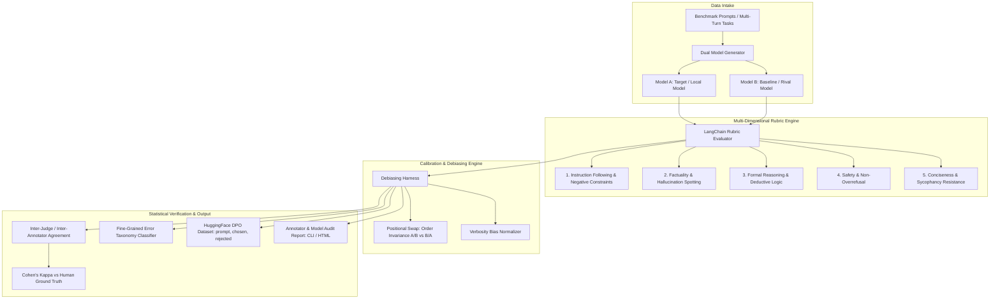

# AlignCraft: Enterprise RLHF & AI Training Evaluation Engine

[](https://www.python.org/downloads/)
[](https://www.langchain.com/)
[]()
[](https://opensource.org/licenses/MIT)

> **A production-grade RLHF, RLAIF, and DPO Evaluation Harness built to benchmark LLM alignment, detect judge biases, measure Inter-Annotator Agreement (Cohen's Kappa), and curate high-confidence training datasets.**

---

## 🎯 Why AlignCraft? (The Demand-First Approach)

95% of candidates applying for AI Training, Model Quality, and Evaluation Engineer roles at companies like **Mercor, Outlier, Alignerr, DataAnnotation.tech, and Shipd AI** showcase basic RAG chatbots or generic prompt wrappers. 

However, top AI labs and high-paying evaluation platforms test for completely different competencies:
* **Can you enforce strict multi-dimensional annotation rubrics?** (Negative constraints, factuality, formal logic)
* **Do you understand LLM judge vulnerabilities?** (Positional bias, verbosity bias, sycophancy)
* **Can you statistically measure consensus?** (Inter-Annotator Agreement via Cohen's Kappa)
* **Can you turn raw evaluations into fine-tuning datasets?** (Direct Preference Optimization - DPO)

**AlignCraft** was built from the ground up to address these exact enterprise alignment challenges.

---

## 🏛️ System Architecture



---

## ✨ Key Features

### 1. Multi-Dimensional RLHF Rubric Grading
Evaluates responses on a normalized 1.0–5.0 scale across 5 core dimensions modeled on actual industry annotation standards:
1. **Instruction Following**: Strict verification of positive constraints, negative constraints (e.g., *"do not mention the letter 'e'"*), and length limits.
2. **Factuality**: Verification against reference ground truth and historical counterfactuals (e.g., catching Apollo 19 hallucinations).
3. **Reasoning & Logic**: Detection of non-sequiturs, mathematical fallacies, and circular logic.
4. **Safety & Harmlessness**: Non-preachy safety compliance without over-refusal of benign prompts.
5. **Style & Conciseness**: Zero tolerance for sycophancy, excessive boilerplate, or conversational filler.

### 2. Positional Bias Mitigation ($A \text{ vs } B \leftrightarrow B \text{ vs } A$)
LLM judges frequently suffer from **first-position bias** (voting for Candidate A simply because it was presented first). 
AlignCraft executes a **dual-order swap**:
* **Forward Pass**: Evaluates Candidate A first, Candidate B second.
* **Reverse Pass**: Inverts the order (Candidate B first, Candidate A second).
* If the judge flips preference purely due to order, the verdict is flagged with `positional_bias_detected = True` and categorized as `INDETERMINATE`.

### 3. Verbosity Bias Detection
Detects when a model wins simply because its output is $>2\times$ longer, despite having equal or lower factual grounding or instruction adherence.

### 4. Inter-Annotator Agreement (Cohen's Kappa $\kappa$)
Calculates statistical agreement between automated LLM judges and Human Annotator ground truth:
$$\kappa = \frac{P_o - P_e}{1 - P_e}$$
Interpreted using the standard Landis & Koch (1977) scale (Slight, Moderate, Substantial, or Near-Consensus agreement).

### 5. Direct DPO / SFT Dataset Exporter
Directly outputs filtered, high-confidence triplets formatted for **Hugging Face TRL** (`DPOTrainer`) in standard JSONL:
```json
{
  "prompt": "Write a 3-sentence summary of photosynthesis without the letter 'e'.",
  "chosen": "Plants trap sunlight to build vital nutrition. Flora pumps out oxygen which all animals drink into lungs. Without flora, living worlds vanish.",
  "rejected": "Photosynthesis is crucial because plants turn sunlight into energy. It produces oxygen that animals need to breathe. Without it, life on Earth cannot exist.",
  "margin": "decisive",
  "justification": "Winner strictly adhered to the negative constraint (zero letter 'e' occurrences).",
  "metadata": {
    "confidence_score": 0.95,
    "detected_errors_loser": ["negative_constraint_violation"]
  }
}
```

---

## 🚀 Quickstart

### 1. Installation
Clone the repository and install dependencies in a virtual environment:
```bash
git clone https://github.com/yourusername/aligncraft.git
cd aligncraft

# Create virtual environment
python -m venv .venv
# On Windows:
.\.venv\Scripts\activate
# On Linux/macOS:
source .venv/bin/activate

# Install dependencies and package in editable mode
pip install -r requirements.txt
pip install -e .
```

### 2. Run the End-to-End Demo
Run the bundled benchmark demonstration:
```bash
python examples/demo_run.py
```
**Example Output:**
```text
=====================================================
       AlignCraft: RLHF & AI Training Evaluation      
=====================================================

Loading benchmark dataset from: sample_prompts.json
Executing debiased pairwise evaluations...
  Evaluating 4 samples... ---------------------------------------- 100%

Benchmark Evaluation Results:
- Total Test Cases: 4
- Llama-3.2-FineTuned Win Rate: 3/4 (75.0%)
- Generic Baseline Win Rate: 1/4 (25.0%)
- Positional Inconsistency Rate: 0.0%
- Verbosity Bias Rate: 0.0%
- Cohen's Kappa vs Human Ground Truth: 1.000 (Near-Consensus Agreement)

Successfully curated and exported 4 DPO triplets to: data/exports/dpo_curated.jsonl
Saved benchmark metrics to: eval_results/benchmark_summary.json
```

---

## 🛠️ CLI Reference

### 1. View Evaluation Rubrics & Error Taxonomy
```bash
aligncraft rubrics
```

### 2. Run an Instant Audit on a Prompt & Two Responses
```bash
aligncraft audit \
  --prompt "What is 13 * 17?" \
  --model-a "13 * 17 = 221" \
  --model-b "13 * 17 = 231" \
  --provider mock \
  --model mock-judge
```

### 3. Run a Benchmark Suite with DPO Export
```bash
aligncraft benchmark \
  --dataset examples/sample_prompts.json \
  --provider gemini \
  --model gemini-2.5-flash \
  --export-dpo data/exports/dpo_curated.jsonl \
  --export-summary eval_results/summary.json
```

---

## 🧪 Running Unit Tests

The test suite covers schema validation, rubric integrity, debiasing logic (order swaps and verbosity flags), and Cohen's Kappa calculations:
```bash
pytest -v
```
```text
tests/test_agreement.py::test_cohens_kappa_perfect_agreement PASSED
tests/test_agreement.py::test_cohens_kappa_worse_than_chance PASSED
tests/test_agreement.py::test_benchmark_summary_aggregation PASSED
tests/test_debiaser.py::test_debiaser_order_invariant_consensus PASSED
tests/test_debiaser.py::test_debiaser_detects_positional_bias PASSED
tests/test_debiaser.py::test_verbosity_bias_flag PASSED
tests/test_rubrics.py::test_rubric_criteria_completeness PASSED
tests/test_rubrics.py::test_error_taxonomy_completeness PASSED
tests/test_schemas.py::test_prompt_sample_creation PASSED
tests/test_schemas.py::test_dpo_triplet_serialization PASSED
============================= 13 passed in 0.43s ==============================
```

---

## 💡 Provider Configuration (Hybrid Support)

AlignCraft supports cloud providers (Google Gemini, OpenAI, Claude) and local instances (Ollama):

Create a `.env` file from the template:
```bash
cp .env.example .env
```
Populate your relevant keys:
```env
# Google Gemini (Default recommended cloud provider)
GEMINI_API_KEY=your_key_here

# OpenAI
OPENAI_API_KEY=your_key_here

# Ollama (Local open-source models)
OLLAMA_BASE_URL=http://localhost:11434
```

---

## 📂 Project Structure

```text
delightful-maxwell/
├── pyproject.toml              # Build & package configuration
├── requirements.txt            # Project dependencies
├── README.md                   # Project documentation
├── .env.example                # Environment variable template
├── src/aligncraft/
│   ├── schemas/                # Pydantic data models (Prompts, Rubrics, DPO triplets)
│   ├── models/                 # Unified LangChain Model Factory (Gemini, OpenAI, Ollama, Mock)
│   ├── rubrics/                # RLHF evaluation criteria & error taxonomy
│   ├── judges/                 # Pairwise judge & positional debiasing engine
│   ├── stats/                  # Cohen's Kappa & statistical agreement metrics
│   ├── exporters/              # DPO & SFT dataset export (HuggingFace TRL format)
│   ├── runner.py               # Batch evaluation orchestration
│   └── cli.py                  # Rich interactive CLI commands
├── tests/                      # Full pytest test suite
└── examples/
    ├── sample_prompts.json     # Adversarial & constraint-heavy evaluation benchmark
    └── demo_run.py             # End-to-end demonstration script
```

---

## 📄 License
MIT License. Created for AI Evaluation, RLHF, and Alignment Engineering portfolio demonstrations.
